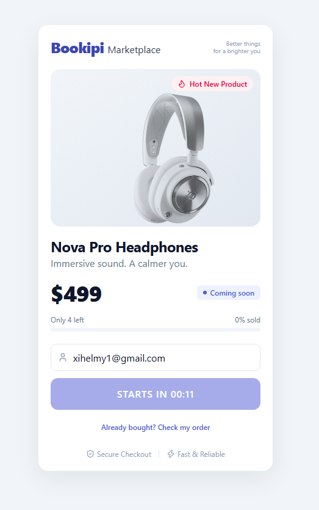
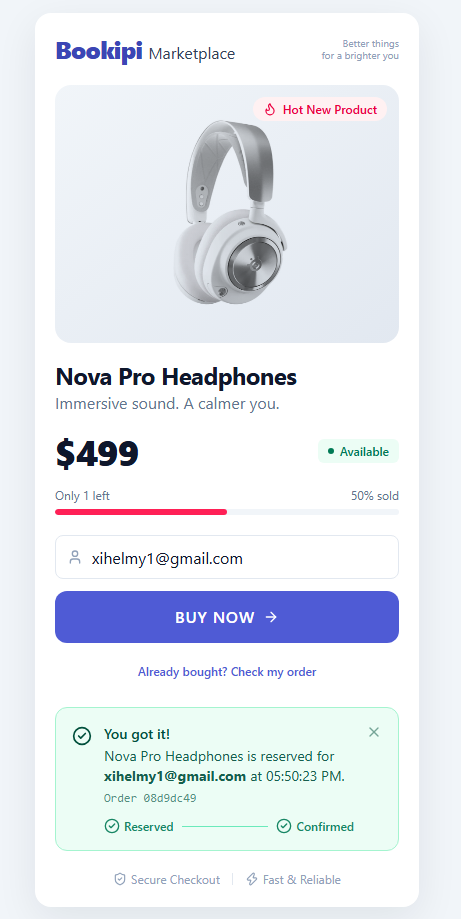
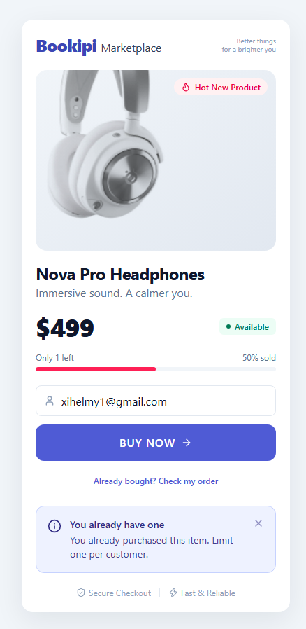
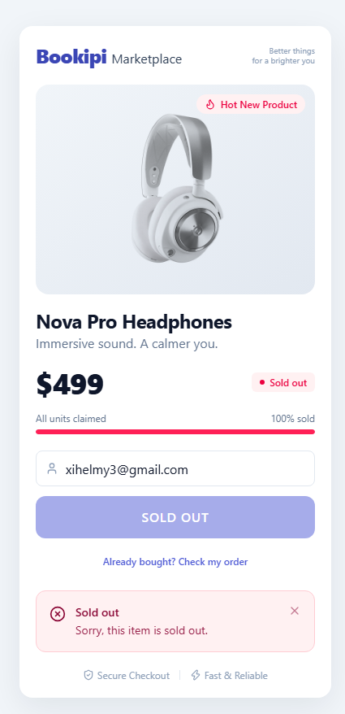
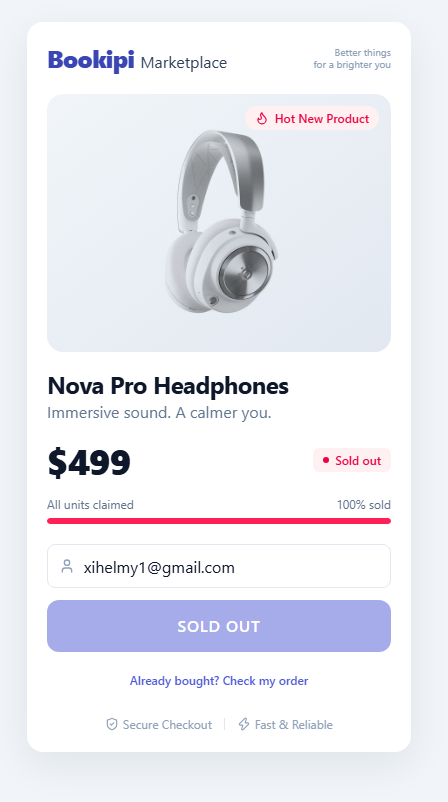
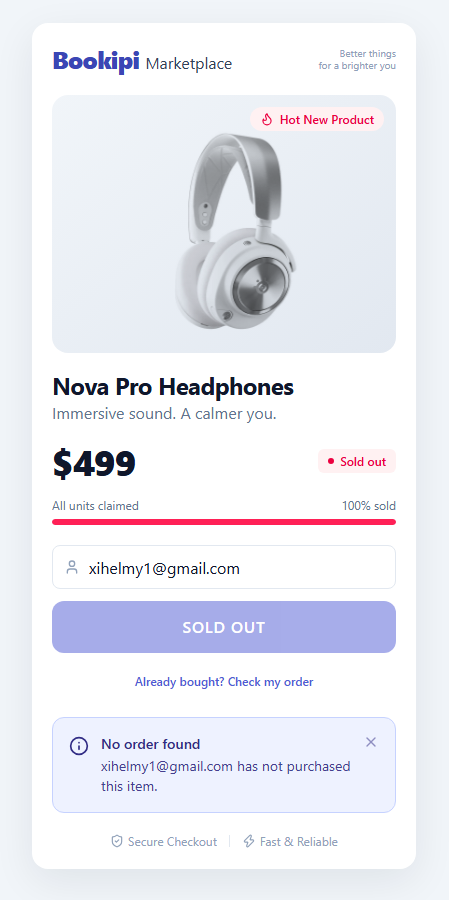
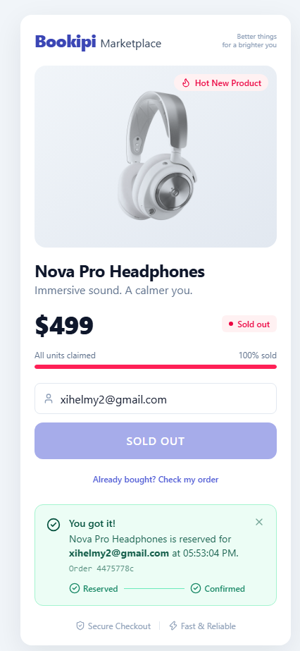
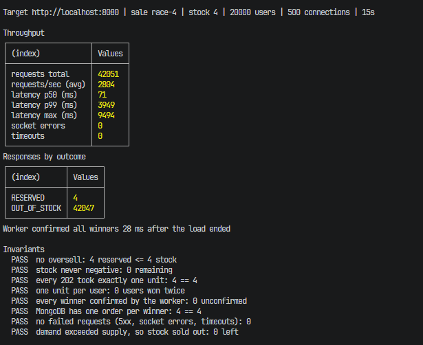
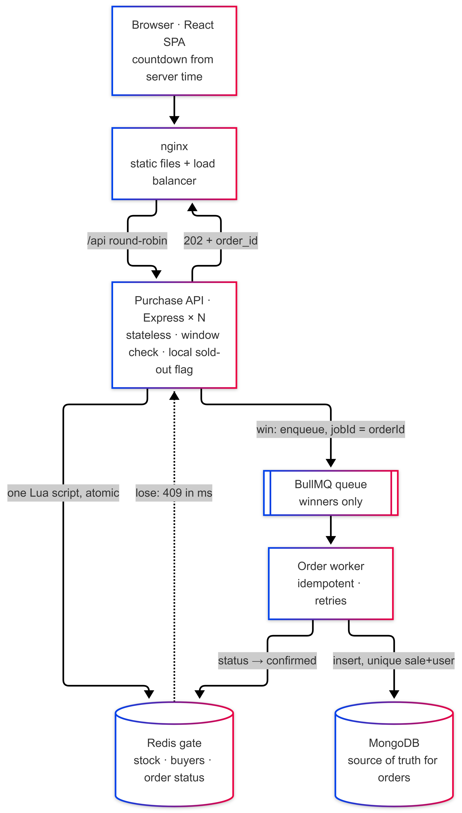
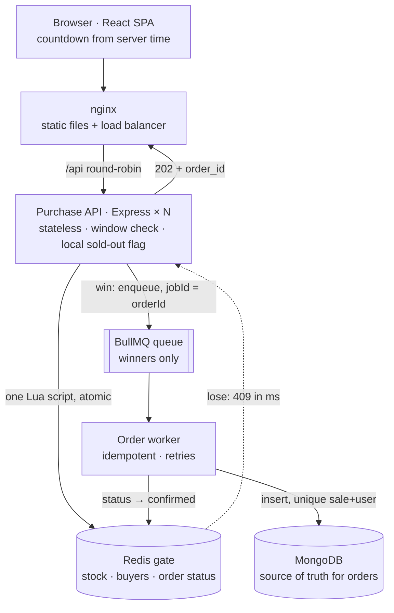

# Flash Sale

A flash sale for one hot product, the **Nova Pro Headphones** at $499: a fixed sale window, limited stock, one unit per user, first come first served. It is built to take a burst of concurrent buyers without overselling.

**The core idea:** decide "win or lose" in one atomic step in Redis, before anything else. Losers get an answer in milliseconds and never touch the database. Only winners continue, through a queue, to MongoDB.

- **Backend:** Node.js 22, TypeScript, Express 5, Redis (ioredis), BullMQ, MongoDB, zod, pino
- **Frontend:** React 18, Vite, Tailwind CSS 4, shadcn-style components (no component library)
- **Tests:** Jest + supertest (unit and integration), autocannon (stress)

## Quick start

You only need **[Docker](https://docs.docker.com/get-docker/)**: Docker Desktop on macOS and Windows, or Docker Engine with the Compose plugin on Linux. Node.js is not needed to run the app. The steps are the same on every OS.

**1. Start Docker** (open Docker Desktop and wait until it says it's running).

**2. Get the code:**

```bash
git clone <this-repo-url> flash-sale
```

```bash
cd flash-sale
```

**3. Start everything** (the first build takes a few minutes):

```bash
docker compose up --build --scale api=3
```

That starts nginx, 3 API replicas, the order worker, Redis and MongoDB. It's ready when the log shows `api started`.

**4. Open http://localhost:8080.** You'll see a countdown: the sale opens 15 seconds after the first start, has 100 units and runs for 30 minutes.

### Try it

| To see | Do this |
|---|---|
| A successful purchase | Wait for the countdown, enter any name or email, click **Buy now**. The order goes from *Reserved* to *Confirmed* within a second. |
| One per user | Click **Buy now** again with the same name: *You already have one*. |
| Checking an order | Click **Already bought? Check my order**. |
| Sold out, with a real race | Open a second browser window for each extra buyer, or fire 50 buyers at once from the browser console (see [Testing the race in the browser](#testing-the-race-in-the-browser)). |
| The full stress test | See [Stress test](#stress-test). |

A sale of 100 units takes a while to sell out by hand, so for a quick demo use a small one. Copy `.env.example` to `.env`, set `SALE_ID=demo` and `STOCK=3`, then restart with the command in step 3.

### Stop and start over

- **Stop:** `Ctrl+C` in the terminal, or `docker compose down` from another one.
- **Start a fresh sale:** a sale is created once per `SALE_ID`, so after it ends or sells out, either change `SALE_ID` in `.env` or wipe all data with `docker compose down -v`, then run step 3 again. Details in [Resetting](#resetting-or-running-a-new-sale).

### Troubleshooting

| Problem | Fix |
|---|---|
| `Cannot connect to the Docker daemon` / `pipe ... docker_engine` | Docker isn't running. Start Docker Desktop and wait for it. |
| `port is already allocated` (8080, 6379 or 27018) | Another program uses that port, often a local Redis on 6379. Stop it, or change the left-hand port in `docker-compose.yml`. |
| The page says **Sale ended** or **Sold out** right away | That `SALE_ID` was used before. Set a new `SALE_ID` in `.env`, or run `docker compose down -v`, then start again. The API log names any setting it ignored. |
| The page shows **Connection lost** | The API is still starting or was stopped. It recovers on its own within a few seconds. |

## Screenshots

<table>
  <tr>
    <td align="center"><br>Countdown before opening</td>
    <td align="center"><br>Sale open</td>
    <td align="center"><br>Purchase reserved, then confirmed</td>
  </tr>
  <tr>
    <td align="center"><br>One per user</td>
    <td align="center"><br>Sold out (lost the race)</td>
    <td align="center"><br>Sold out (page state)</td>
  </tr>
  <tr>
    <td align="center"><br>Check my order: none</td>
    <td align="center"><br>Check my order: found</td>
    <td align="center"><br>Sale ended</td>
  </tr>
</table>

Stress test against the Docker stack (500 connections, 4 units): 42,051 requests, exactly 4 sold, every check passing.



## Architecture



<details>
<summary>Diagram source (Mermaid)</summary>



</details>

**Buy Now flow:**

1. The page shows a countdown corrected by the server's clock, and unlocks the button at the start time.
2. `POST /api/v1/flash-sale/purchases { user_id }`.
3. The API checks the cheap things first: valid input, sale window (server time), and a **local sold-out flag**. Any of these can reject without touching Redis.
4. One Lua script in Redis, atomically: already bought? → `409 ALREADY_PURCHASED`. No stock? → `409 OUT_OF_STOCK`. Otherwise take one unit, record buyer → order id, and set the order status to `reserved`.
5. **Win:** the API enqueues a `create-order` job (job id = order id) and returns `202 { order_id, status: "reserved" }` immediately.
6. The worker inserts the order into MongoDB, then sets its status in Redis to `confirmed`. The UI shows **Reserved → Confirmed** by polling `GET /purchases/:user_id`.

### Why each part is there

| Part | Why |
|---|---|
| **nginx** | Serves the SPA and round-robins `/api` across replicas. It re-resolves `api` every 5s, so scaled or restarted replicas are picked up without a reload. In the cloud: CDN + ALB. |
| **Purchase API** | Stateless, so it scales out. It rejects outside the window and after sell-out from memory, so bots hammering before the start or after the end cost no Redis calls. |
| **Redis gate** | The only place that decides who wins. Redis runs one script at a time, so nothing can happen between "read stock" and "take a unit". |
| **BullMQ** | Only winners enter it. It decouples the database's speed from the burst, and retries with backoff if MongoDB is slow or down. It reuses the Redis we already run. |
| **Worker + MongoDB** | Saves orders at a pace MongoDB can handle. The unique index on `(sale_id, user_id)` is the last safety net for "one per user", independent of Redis. |

### How each requirement is met

| Requirement | Where it's enforced |
|---|---|
| Starts (and ends) at a set time | The API checks the server clock before touching Redis (`403 SALE_NOT_STARTED` / `SALE_ENDED`). The client countdown is display only. |
| Requests exceed stock | The stock counter in the Lua script never goes below 0. In the stress test, about 97% of requests are cheap rejections (`SALE_NOT_STARTED` during the countdown, then `OUT_OF_STOCK`). |
| One unit per user | The buyers hash inside the same Lua script, then the unique `(sale_id, user_id)` index in MongoDB. User ids are trimmed and lowercased first. |
| No add-to-cart | One endpoint reserves directly. |
| First come, first served | Redis serves requests in the order they arrive at the single decision point. "Sold out" is the same atomic step as taking the last unit. |

## Design choices and trade-offs

**Why Redis + Lua instead of a database lock.** `SELECT … FOR UPDATE` queues every buyer on one row lock, and throughput collapses exactly at the peak. `UPDATE … WHERE stock > 0` is correct but costs a disk transaction per attempt, losers included. A distributed lock adds lease edge cases for no benefit, because the script already is the critical section.

**Why the queue sits after the gate, not before it.** If every request entered the queue and the worker decided, 100,000 users would wait behind each other just to hear "sold out". With the gate first, losers are answered in milliseconds and the queue only ever holds `stock` jobs.

**Why `202 Accepted`.** The unit is truly reserved when the API answers. The order is saved asynchronously, so `reserved` is honest. The UI shows it moving to `confirmed`, typically within a second.

**The local sold-out flag.** Once Redis answers "sold out" to an instance, stock can't come back within this sale, so that instance answers every later attempt from memory. The trade-off: a winner who retries after sell-out sees `OUT_OF_STOCK` rather than `ALREADY_PURCHASED`. The "Check my order" button covers that case.

**Closing the gap between winning and enqueueing.** If the API crashes after the Lua win but before `enqueue`, the unit is taken but no job exists. The client never got a response, so it retries. The retry hits `ALREADY_PURCHASED`, and that path **re-enqueues the existing order**. The gate hands back the original reservation (the buyers hash stores `orderId|reservedAt`), so the repaired order keeps its true reservation time. The job id is the order id, so this is a no-op when the job already exists and a repair when it doesn't. An integration test simulates exactly this crash. For users who never retry, a reconciliation sweep (`reserved` orders older than N minutes without a job) is the next step; it isn't built.

**Everyone agrees on one sale.** On boot, every instance runs an `initSale` script that writes the sale definition only if it doesn't exist yet, then uses what is stored. Restarting or scaling never resets stock, and replicas share one window. A new sale needs a new `SALE_ID`; keys are namespaced `flashsale:{saleId}:*`. The `{…}` hash tag keeps them in one Redis Cluster slot, which multi-key scripts require.

**Mocked vs real services.** As the brief suggests, managed cloud services run locally in Docker instead: Redis stands in for ElastiCache or Memorystore, MongoDB for Atlas, BullMQ on Redis for SQS or RabbitMQ, and nginx for a CDN plus load balancer. Rate limiting, WAF and bot protection belong at the edge and are described, not built.

### Code structure

The backend is organised by feature module, layered as **Routes → Controllers → UseCases → Repositories**, with one folder per layer inside each module. Dependencies are passed in through constructors, and only the composition roots (`src/index.ts` for the API, `src/worker.ts` for the worker) know the concrete classes and wire them together.

- **Controllers** only translate HTTP: validate input with a zod schema from `validations/`, call the usecase, write `{ data }`.
- **UseCases** hold the business rules: one class per operation (`CreatePurchaseUsecase`, `GetFlashSaleDetailUsecase`, `GetPurchaseDetailUsecase`), each with a single `exec()`. They take plain values (`{ userId }`), never Express's `req`, so the same logic runs from HTTP, a worker or a test. Each is created once and shared by all requests, which is how `CreatePurchaseUsecase` keeps its local sold-out flag.
- **Repositories** own Redis and MongoDB access, and turn infrastructure failures into a client-safe `SERVICE_UNAVAILABLE`.
- **Modules don't import each other.** Each owns the small interface it needs from the outside: `CreatePurchaseUsecase` depends on an `OrderPublisher` (`enqueue`), and the order processor on an `OrderStatusWriter` (`markConfirmed`). The composition roots plug in `OrderQueue` and `FlashSaleRepository`. Order status lives in the sale's Redis state because "reserved" must be written in the same atomic script as the stock decrement; the interface keeps that fact out of the order module.
- **Errors:** business code throws `AppError(code, message)`, which carries no HTTP status. The single error middleware (`shared/http/error-handler.ts`) maps each code to a status and title and writes RFC 9457 Problem Details. Express 5 forwards async errors there, so controllers need no try/catch.

**Response format.** Success is the resource in `{ data }`, with the HTTP status as the only success signal. Errors follow the IETF standard, [RFC 9457](https://www.rfc-editor.org/rfc/rfc9457) ("Problem Details for HTTP APIs"). There is deliberately no `success` flag, which would only repeat the status code and can disagree with it. There's also no server-side `duration` in the payload, because precise per-request timings help an attacker distinguish internal code paths.

### Failure handling

| Failure | Behaviour |
|---|---|
| An API instance crashes | Instances hold no state; nginx routes to the others. On `SIGTERM`, both processes drain in-flight work, with a 10s deadline so a stuck dependency can't hang shutdown. The keep-alive timeout (65s) outlives nginx's (60s), avoiding sporadic 502s. |
| Redis unreachable or slow | No offline queue, 1 retry, 1s timeout: requests **fail fast with 503** instead of piling up. Nothing is sold without Redis confirming. The UI shows "Try again", which is safe because purchases are idempotent per user. |
| Client loses the response | Retrying returns `ALREADY_PURCHASED` (and repairs a missing job). "Check my order" shows the order and its status. |
| Worker crashes or MongoDB is down | Jobs stay in BullMQ and retry with exponential backoff (10 attempts). Users already hold their order id and see `reserved` until the worker catches up. |
| A job runs twice | Insert by `_id = order_id`: a duplicate is recognised as the same order and treated as success. A *different* order for the same user is rejected by the unique index, and the job is failed for review without retrying. |
| Redis restarts | AOF (`appendfsync everysec`) restores stock, buyers and statuses. |

**Known gap, stated honestly:** with `everysec`, a hard Redis crash can lose up to about 1s of writes, and replication is asynchronous, so a failover can lose the latest writes too. Neither oversells (the decrement is lost with the reservation), but a just-reserved order could vanish. MongoDB keeps every order the worker has already saved. Mitigations, cheapest first: `WAIT 1 <timeout>` after the script, `appendfsync always`, or a reconciliation job that rebuilds Redis state from MongoDB.

**Out of scope:** authentication (`user_id` comes from the body, as the brief describes; in production it comes from the session), payment with a reservation hold and expiry (unpaid orders would release the unit with `INCR` + `HDEL`), and admin APIs.

## API

Success responses are `{ "data": ... }`. Failures are RFC 9457 Problem Details (`Content-Type: application/problem+json`), with `code` as an extension member so clients can branch without parsing the `type` URI:

```http
HTTP/1.1 409 Conflict
Content-Type: application/problem+json

{
  "type": "urn:problem-type:flash-sale:out-of-stock",
  "title": "Out of stock",
  "status": 409,
  "detail": "Sorry, this item is sold out.",
  "code": "OUT_OF_STOCK"
}
```

Validation problems add an `errors` array, e.g. `"errors": [{ "field": "user_id", "message": "is required" }]`.

| Method | Path | Result |
|---|---|---|
| `GET` | `/api/v1/flash-sale` | `200` `{ sale_id, product, status, starts_at, ends_at, total_stock, remaining_stock, server_time }`. `status`: `upcoming` · `active` · `sold_out` · `ended` |
| `POST` | `/api/v1/flash-sale/purchases` | Body `{ "user_id": "alice@example.com" }`<br/>`202` `{ order_id, user_id, status: "reserved", reserved_at }`<br/>`409 ALREADY_PURCHASED` · `409 OUT_OF_STOCK` · `403 SALE_NOT_STARTED` · `403 SALE_ENDED` · `400 VALIDATION_ERROR` · `503 SERVICE_UNAVAILABLE` (safe to retry) |
| `GET` | `/api/v1/flash-sale/purchases/:user_id` | `200` `{ user_id, purchased, order: { order_id, status, reserved_at, confirmed_at } \| null }` |
| `GET` | `/health` | `200` |

## Running it

Every command below works the same on macOS, Linux and Windows. Settings go in a `.env` file rather than shell-specific environment syntax.

### Everything in Docker

```bash
docker compose up --build --scale api=3
```

Open http://localhost:8080. See [Quick start](#quick-start).

### Local development (hot reload)

Needs Node.js 20.12+ and npm, plus Docker for Redis and MongoDB. MongoDB is published on host port **27018**, so it never collides with a MongoDB already installed on your machine.

```bash
npm install
```

```bash
docker compose up -d redis mongo
```

Then run each of these in its own terminal:

```bash
npm run dev:server
```

```bash
npm run dev:worker
```

```bash
npm run dev:web
```

Open http://localhost:5173.

### Configuring the sale

Copy `.env.example` to `.env` in the project root and edit it. Docker Compose reads `.env` automatically, and so does the dev server. Every value is optional.

| Variable | Default | Accepts |
|---|---|---|
| `SALE_ID` | `launch` | Any name. Namespaces the sale's Redis keys and order queue. |
| `SALE_START` | `15s` | A delay after the sale is first created (`30s`, `5m`, `1h`), or an exact ISO-8601 time (`2026-11-11T00:00:00Z`) |
| `SALE_END` | `30m` | A duration after the start (`30m`, `2h`), or an exact ISO-8601 time |
| `STOCK` | `100` | A non-negative integer |
| `REDIS_URL` · `MONGO_URL` | `redis://127.0.0.1:6379` · `mongodb://127.0.0.1:27018/flash_sale` | Local dev only; Docker Compose sets its own |
| `PORT` · `LOG_LEVEL` | `3000` · `info` | |

For example, a 2-minute sale of 5 units that opens 30 seconds after start:

```dotenv
SALE_ID=demo
SALE_START=30s
SALE_END=2m
STOCK=5
```

A sale is **created once per `SALE_ID`**, the first time the API starts with it, and every instance then uses the stored window and stock. That's what stops a restart or a newly scaled replica from resetting stock mid-sale. It also means editing `.env` doesn't change a sale that already exists. The API logs a warning naming any setting it ignored, and refuses to start on stored sale data it can't read.

### Resetting or running a new sale

Pick whichever fits:

- **Run a new sale and keep the old data:** change `SALE_ID` in `.env` (e.g. `demo-2`), then restart (`docker compose up --build --scale api=3`, or restart `dev:server` and `dev:worker`).
- **Wipe everything and start fresh:** stop the stack and delete its Redis and MongoDB data, then start again. Your `.env` stays as it is.

```bash
docker compose down -v
```

```bash
docker compose up --build --scale api=3
```

### Building

`docker compose up --build` builds everything inside the images (see `server/Dockerfile` and `web/Dockerfile`). To build and run the production output without Docker for the app itself (Redis and MongoDB still come from `docker compose up -d redis mongo`):

```bash
npm install
```

```bash
npm run build
```

That compiles the server (TypeScript → `server/dist`) and the frontend (Vite → `web/dist`). Then run each of these in its own terminal:

```bash
npm start -w server
```

```bash
npm run start:worker -w server
```

```bash
npm run preview -w web
```

Open http://localhost:4173. Vite's preview server serves the built frontend and proxies `/api` to the API on port 3000. In Docker, nginx does the same job.

## Tests

```bash
npm install
```

```bash
npm test
```

That runs the unit tests, which need nothing else. To also run the integration suites against real Redis and MongoDB (39 tests in total), start them first:

```bash
docker compose up -d redis mongo
```

```bash
npm run test:all
```

The integration suites use Redis database 15 and a separate `flash_sale_test` database, so they never touch the app's data.

| Suite | Needs | Covers |
|---|---|---|
| `create-purchase.usecase.test.ts` (unit) | — | Window boundaries (start inclusive, end exclusive), Redis untouched outside the window, enqueue on win, re-enqueue on `ALREADY_PURCHASED` with the original reservation time, local sold-out flag stops Redis calls, queue failure surfaces as 503 |
| `get-flash-sale-detail.usecase.test.ts` (unit) | — | Product, window, stock and server time; `upcoming` / `active` / `sold_out` / `ended` |
| `get-purchase-detail.usecase.test.ts` (unit) | — | The order and its status for a buyer; nothing for a non-buyer |
| `create-order.processor.test.ts` (unit) | — | Save then confirm; a retried job is a no-op; a conflicting order fails without retrying; transient errors propagate for retry |
| `flash-sale.repository.test.ts` | Redis | **1,000 concurrent users vs 50 units: exactly 50 win.** **200 concurrent requests from one user: exactly 1 wins**, and every loser points at the winning order. Reserved → confirmed. Re-init keeps stock. Unreachable Redis fails fast with a safe 503. |
| `flash-sale.api.test.ts` | Redis | HTTP end to end with the real BullMQ queue: 202 → 409 → 409, exactly one job enqueued, the exact RFC 9457 body and content type, field-level `errors` for validation, malformed JSON, 404 |
| `order.repository.test.ts` | MongoDB | The same order twice is a no-op; a different order for the same user is rejected by the unique index |
| `order.worker.test.ts` | Redis + MongoDB | The whole winner pipeline with a real BullMQ worker: purchase → queue → MongoDB → `confirmed`. **And the crash case:** a unit won but never enqueued is repaired by the user's retry, keeping the original reservation time. |

Unit tests receive plain fakes through constructors; nothing is module-mocked.

## Stress test

Needs Redis and MongoDB running (`docker compose up -d redis mongo`):

```bash
npm run stress
```

[`flash-sale.stress.ts`](server/tests/stress/flash-sale.stress.ts) builds and boots the **API and the worker** with a fresh sale of 1,000 units that **opens a few seconds into the run** (`START_DELAY_MS`, default 8s after boot). So the crowd is already hammering the button when the countdown hits zero, which is the moment a flash sale is hardest. The load comes from autocannon: 500 connections for 15s, each request buying as a random user from a pool of 20,000, so users retry many times. Afterwards it waits for the worker to drain the queue and checks every invariant, exiting non-zero on any failure:

1. **No oversell:** reserved ≤ stock, and remaining stock ≥ 0.
2. **Accounting:** number of `202` responses = units taken from stock.
3. **One per user:** no user received `202` twice.
4. **Pipeline:** every winner's order reaches `confirmed`.
5. **Durability:** MongoDB holds exactly one order per winner.
6. **No failed requests:** zero 5xx, socket errors or timeouts.
7. **Turned away before the opening:** requests during the countdown got `SALE_NOT_STARTED`.
8. **Nothing sold early:** the earliest reservation is at or after `starts_at`.
9. **Sold out:** demand far exceeded supply, so stock reached 0.

To load-test the full Docker stack (nginx and 3 replicas) instead, start it, then:

```bash
npm run stress:docker
```

That targets http://localhost:8080 with 200 concurrent connections, the most the three-replica stack sustains on one laptop without long queueing (see [Capacity](#capacity-where-it-saturates) below). Any URL and level works, e.g. `npm run stress -w server -- --target <url> --connections 500`.

The opening checks run when the sale is still `upcoming` at the start of the run. To catch the opening, start the stack with a fresh `SALE_ID` and a `SALE_START` of about `15s` in `.env`, and run the stress test as soon as it's up. A sale that wouldn't open until after the load ends is refused up front, with a message. `STOCK`, `USERS`, `DURATION` and `START_DELAY_MS` can be tuned as environment variables.

### Testing the race in the browser

No tools needed: with the app open at http://localhost:8080 and the sale running (a small one, e.g. `STOCK=2`, makes it obvious), open the browser's developer tools (F12) → **Console** and paste:

```js
const results = await Promise.all(
  Array.from({ length: 50 }, (_, i) =>
    fetch('/api/v1/flash-sale/purchases', {
      method: 'POST',
      headers: { 'content-type': 'application/json' },
      body: JSON.stringify({ user_id: `racer-${i}` }),
    }).then(async (r) => (r.status === 202 ? 'RESERVED' : (await r.json()).code)),
  ),
)
console.table(results.reduce((n, code) => ({ ...n, [code]: (n[code] ?? 0) + 1 }), {}))
```

That's 50 buyers at the same instant. With `STOCK=2` you get exactly 2 `RESERVED` and 48 `OUT_OF_STOCK`, and the page switches to **Sold out** on its own. Replace `` `racer-${i}` `` with `'greedy'` to send 50 requests from one user: exactly 1 `RESERVED` and 49 `ALREADY_PURCHASED`.

### Results

Measured on one Windows laptop, with the load generator on the same machine. Treat absolute numbers as a floor.

| Setup | Requests | Req/s | p50 | p99 | Turned away before opening | Reserved | Double wins | Mongo orders | Confirmed after load | Failed requests |
|---|---|---|---|---|---|---|---|---|---|---|
| API + worker, local processes, 15s | 36,215 | 2,415 | 187 ms | 488 ms | 8,533 | 1000 / 1000 | 0 | 1000 | 0.7s | **0** |
| 3 API replicas + worker + nginx (Docker), 200 connections, 15s (`npm run stress:docker`) | 39,595 | 2,640 | 52 ms | 460 ms | 13,894 | 1000 / 1000 | 0 | 1000 | 1.3s | **0** |

How to read these:

- **Correctness held in every run**, including across 3 independent API processes: exactly 1,000 units, no double winners, nothing reserved before the opening (the first reservation landed in the opening millisecond), every winner confirmed, and exactly 1,000 orders in MongoDB.
- **Losers are cheap.** Almost every request was rejected without taking a unit: about a quarter during the countdown, which never reaches Redis, and about three quarters `OUT_OF_STOCK`, most of them answered from the local sold-out flag without a Redis call.
- **The database never sees the burst.** MongoDB received exactly 1,000 inserts, and the worker finished about 1 second after the load ended.
- **Correctness doesn't depend on load.** Every run in the capacity table below, including the overloaded ones, sold exactly the stock with no double wins.

### Capacity: where it saturates

To find the bottleneck, the Docker stack was run with a different number of API replicas and concurrent connections, sampling container CPU mid-run (12-CPU laptop, load generator on the same machine):

| API replicas × connections | Req/s | p99 | Slowest | Failed (over 10s) | API container CPU |
|---|---|---|---|---|---|
| 1 × 500 | 1,092 | 1,837 ms | 9.9 s | 333 | 135% (saturated) |
| 3 × 100 | 2,671 | 167 ms | 0.8 s | 0 | ~100% each |
| 3 × 200 | 2,933–3,072 | 277–335 ms | 2.8–4.3 s | 0 | ~100% each |
| 3 × 300 | 3,132 | 854 ms | 8.5 s | 0 | ~105% each |
| 3 × 500 | 1,945–2,883 | 2.1–4.3 s | 6.9–10 s | 0–134 | ~80–100% each |

What this shows:

- **The bottleneck is API CPU.** Redis stays far from its limit, and nginx's timed access log (`rt` = total time, `urt` = time the API took) shows slow requests waiting on an API replica.
- **Past saturation, more concurrency only adds queueing.** Three replicas top out around 3,000 req/s here. Beyond about 200 connections, extra connections don't raise throughput, they lengthen the queue: 500 connections served *fewer* requests per second than 100. The slowest requests then wait long enough to hit the 10s client timeout. One replica shows the same thing earlier.
- **The fix is horizontal.** Going from 1 to 3 replicas took throughput from 1,092 to about 3,000 req/s and removed the timeouts. In production, autoscaling the stateless API (on CPU or request latency) and a waiting room or edge rate limiting in front keep the queue short. A natural next step, not built here, is load shedding: an API that answers a fast `503` with `Retry-After` when its event loop falls behind, instead of letting requests queue for seconds.
- **The single-process local run is faster** because it skips nginx and Docker's network: it handled 500 connections with zero failures and a worst case of about 1s.
- **The bottleneck is the Node process, not Redis**, so throughput scales by adding API replicas until Redis's single core (around 100k scripts/s) becomes the limit. Past that, put a waiting room in front.

## Project layout

```
server/src/
  index.ts                     API composition root: Redis, queue, usecases, Express; graceful shutdown
  worker.ts                    worker composition root: MongoDB, BullMQ worker
  app.ts                       Express app: JSON limit, routes, 404 + error handler
  config/                      env.ts, redis.ts
  shared/
    app-error.ts               AppError + ErrorCode (no HTTP knowledge)
    http/error-handler.ts      the one place codes become HTTP statuses; writes RFC 9457 problems
    http/validate.ts           zod parse → VALIDATION_ERROR with field errors
    logger.ts · shutdown.ts    pino; SIGINT/SIGTERM handling with a deadline, shared by both processes
  modules/flash-sale/
    flash-sale.routes.ts · flash-sale.types.ts · flash-sale.rules.ts (sale phase)
    controllers/               flash-sale.controller.ts
    usecases/                  get-flash-sale-detail, create-purchase (owns OrderPublisher), get-purchase-detail
    repositories/              flash-sale.repository.ts: Redis gate (Lua), order status
    validations/               purchase.validation.ts (zod)
    tests/                     one unit test per usecase
  modules/order/
    queues/                    order.queue.ts: BullMQ producer (jobId = orderId)
    processors/                create-order.processor.ts: save to MongoDB, mark confirmed; owns OrderStatusWriter
    repositories/              order.repository.ts: MongoDB orders + unique (sale_id, user_id)
    tests/
server/tests/
  integration/                 repository, API, MongoDB and worker pipeline tests against real services
  stress/                      autocannon load test with invariant checks
web/src/
  components/ui/               button, input, card, badge (shadcn-style, Tailwind)
  lib/                         fetch client (unwraps { data }, reads problem+json), formatting, cn()
  features/flash-sale/
    api.ts · flash-sale-page.tsx
    components/                product summary, purchase form, purchase result
    hooks/                     use-sale (polling + server clock), use-purchase-flow
docker-compose.yml             redis + mongo + api (scalable) + worker + web
```
